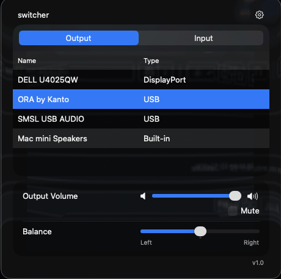
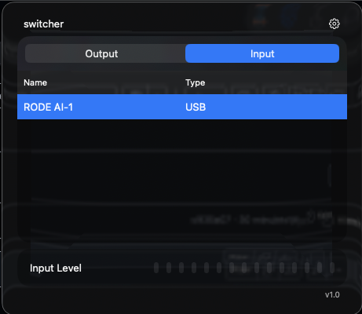
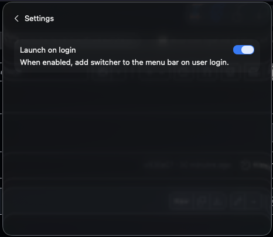

# switcher





Menubar app to manage audio inputs/outputs on the fly without having to
go into settings menu and reflects current device state if changed from
anywhere in the system.

Currently supports normal macOS system controls for most USB audio devices
and prompts user to add it as a startup item, some things to look into later:

- controlling volume on monitors with built-in speakers (likely involves
  DDC/CI protocol shenanigans).
- controlling input volume for various BLE headsets like airpods
- general testing of various devices (i.e, speakers that support surround
  sound (preliminary support is there, service class checks for channel
  layout of device).
- per application volume (mixer tab) is built on Core Audio process taps
  (macOS 14.2+) and needs the "System Audio Recording" permission. Only apps
  that have played sound (remembered across launches) are listed, split into
  channels when an app plays from more than one process (e.g. Discord voice
  chat vs notifications). Helper processes
  (e.g. Safari's WebKit GPU process) are attributed to their app via the private
  `responsibility_get_pid_responsible_for_pid` call.

## local install

### requirements

- macOS 26 or later (the app's deployment target)
- Xcode 26 or later. After installing or updating Xcode, run
  `xcodebuild -runFirstLaunch` once. If `xcodebuild` fails with
  "A required plugin failed to load", that is the fix.

### build

All commands run from the repo root. `-derivedDataPath build` keeps the output
in `./build` (gitignored) instead of `~/Library/Developer/Xcode/DerivedData`.

```bash
# recommended: signed with the project's development team. Needs a valid
# "Apple Development" certificate for that team in your keychain
# (Xcode > Settings > Accounts creates and renews it).
xcodebuild -scheme switcher -configuration Release \
  -destination 'platform=macOS' -derivedDataPath build build

# fallback when you have no certificate for the team: ad-hoc sign. Entitlements
# are still applied, but every build gets a new signature, so macOS asks for
# microphone / system audio permission again after each rebuild.
xcodebuild -scheme switcher -configuration Release \
  -destination 'platform=macOS' -derivedDataPath build build \
  CODE_SIGN_STYLE=Manual CODE_SIGN_IDENTITY=- DEVELOPMENT_TEAM=
```

The app ends up at `build/Build/Products/Release/switcher.app`.

### install

```bash
# quit any running copy first so the menubar icon doesn't show up twice
pkill -x switcher
cp -R build/Build/Products/Release/switcher.app /Applications/
open /Applications/switcher.app
```

On first use macOS asks for microphone access (Input tab level meter) and
"System Audio Recording" access (Mixer tab, the first time an app is turned
below 100%). Both can be changed later in System Settings > Privacy & Security.
With a signed build these grants stick across rebuilds, since macOS ties them to
the bundle ID and certificate rather than the exact binary. Switching between
signed and ad-hoc builds makes macOS treat it as a new app and ask again.

If a signed build fails with "No signing certificate ... found", check for an
expired certificate with `security find-identity -p codesigning`
(`CSSMERR_TP_CERT_EXPIRED`) and let Xcode renew it under Settings > Accounts.
Personal Team certificates last a year.

### test

```bash
# unit tests (append the ad-hoc CODE_SIGN_* overrides above if you have no certificate)
xcodebuild test -scheme switcher -destination 'platform=macOS' \
  -only-testing:switcherTests -derivedDataPath build

# misc helper commands
xcodebuild -list
```

Note: several unit tests talk to the real default output device, briefly
changing its balance and mute state.
